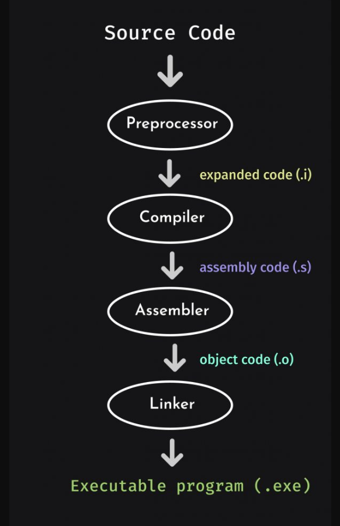

# Compilation Process

## Overview

This is my current understanding of how a C program goes from source code to an executable.

The compilation process can be thought of as **four main steps** that eventually produce one executable file. When we use:

```bash
cc ourprogram.c
```

we get an executable file, but the `cc` command hides the individual steps from us and performs them automatically.

## 1. Preprocessor

The first step is performed by the **preprocessor**. Its job is to process things such as `#include`, `#define`, and conditional compilation directives. It also removes comments.

One of the most important things it does is process:

```c
#include <stdio.h>
```

This effectively makes the declarations from `stdio.h` available to our source code.

At first, I thought `#include` imported the actual functions from another library. However, it mainly gives the compiler the **declarations** it needs to understand how those functions can be used.

For example, the header can tell the compiler that a function such as `printf()` exists and what its parameters look like. The actual implementation—the instructions that make the function work—is not simply copied into our source file.

Without the header, we would have to provide the necessary declarations ourselves.

## 2. Compiler

In the second step, the preprocessed C code is translated into **assembly language**.

Assembly is a human-readable representation of instructions for a particular CPU architecture. At this point, we are no longer working directly with C, but we have not reached machine code yet.

```text
C code → Assembly
```

## 3. Assembler

In the third step, the **assembler** translates the assembly code into **machine code**.

The result is an **object file**, usually with a `.o` extension.

An object file contains machine code, but it is not necessarily a complete executable yet. It also contains information needed by the linker to connect this piece of machine code with other pieces of code and libraries.

```text
Assembly → Machine code + linking information → object file
```

## 4. Linker

The final step is **linking**.

Our program may use functions that are implemented somewhere else. For example, `printf()` is part of the C standard library implementation provided by the system (libc).

The header file gives the compiler the declaration of `printf()`, while the C library contains its compiled implementation.

The linker connects the references in our object file with the corresponding implementations provided by libraries and other object files.

After linking, we have a complete executable program.

```text
Object files + libraries
          ↓
       Linker
          ↓
     Executable
```

## Conclusion

In simple terms, what we are doing is writing a C program that can use functions implemented elsewhere instead of implementing everything ourselves.

The compilation process transforms our source code into machine code, and the linker connects our code with the other compiled code that it depends on.

Eventually, the operating system loads the executable and the CPU executes its machine instructions.

There are many more details underneath this process, especially regarding the operating system, libraries, executable formats, and how programs communicate with hardware. For now, I am going to leave those details alone and focus on understanding the main compilation pipeline.


